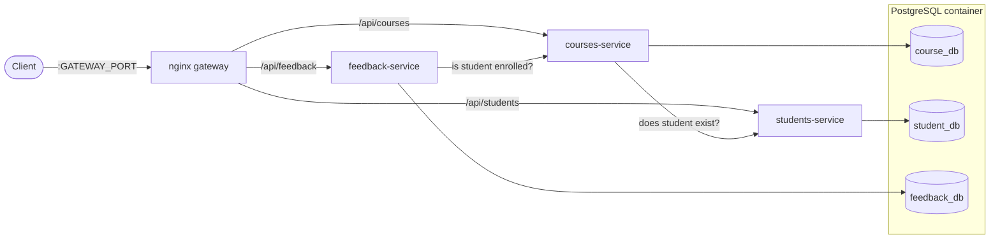

# INFS605 Microservices

A small course-management backend built as three independent TypeScript microservices (**courses**, **students** and **feedback**) behind an nginx API gateway. Each service owns its own PostgreSQL database and talks to the others over HTTP.

## Architecture



- **Gateway**: nginx strips the `/api` prefix and proxies to each service. It tags every request with an `X-Request-ID`, logs it to stdout, answers `GET /health` itself, and returns a JSON `404` for unknown routes.
- **Database per service**: a single Postgres container hosts three databases. On first boot, `db/init-databases.sh` creates each database with its own user and revokes public `CONNECT`, so a service can only reach its own data. Each service creates its tables on startup.
- **Service-to-service calls**:
  - The courses service asks the students service whether a student exists before it enrols one.
  - The feedback service asks the courses service whether the student is enrolled before it accepts feedback.
- **Startup order**: Compose health checks start Postgres first, then the three services, and finally the gateway once every service reports healthy.

## Tech stack

| Layer      | Tools                                                 |
| ---------- | ----------------------------------------------------- |
| Services   | Node.js 22, TypeScript, Express 5, `pg`               |
| Validation | Zod                                                   |
| Data       | PostgreSQL                                            |
| Gateway    | nginx (alpine)                                        |
| Testing    | Jest, ts-jest, Supertest, Testcontainers (PostgreSQL) |
| Runtime    | Docker Compose                                        |

## Getting started

### Prerequisites

- [Docker](https://docs.docker.com/get-docker/) with Docker Compose
- Node.js **22.19 or newer**, needed only to run the tests locally

### 1. Configure environment variables

Copy the template and fill in the values:

```sh
cp .envspec .env
```

| Variable               | Description                                                       |
| ---------------------- | ----------------------------------------------------------------- |
| `POSTGRES_USER`        | Postgres superuser name                                           |
| `POSTGRES_PASSWORD`    | Postgres superuser password                                       |
| `COURSE_DB_PASSWORD`   | Password for `course_user` (courses service)                      |
| `STUDENT_DB_PASSWORD`  | Password for `student_user` (students service)                    |
| `FEEDBACK_DB_PASSWORD` | Password for `feedback_user` (feedback service)                   |
| `GATEWAY_PORT`         | Host port the gateway listens on. `.envspec` sets `3000`; if the variable is unset, Compose falls back to `8080` |

### 2. Start the stack

```sh
docker compose up --build
```

### 3. Check it's running

```sh
curl http://localhost:3000/health
# {"status":"ok"}
```

> **Note:** `db/init-databases.sh` runs only when the Postgres volume is empty. If you change any of the `*_DB_PASSWORD` values after the first boot, reset the volume with `docker compose down -v`. **This deletes all data.**

## API

All routes are documented in the **[Postman collection](https://crimson-robot-321770.postman.co/workspace/My-Workspace~1cb289a1-21f8-4642-80f3-44d598149189/collection/30819450-91f26627-be79-4f03-8028-1871838efd40?action=share&creator=30819450)**. The full schema is in [`openapi.yaml`](openapi.yaml).

> **Note:** Authentication isn't implemented yet (see the [Roadmap](#roadmap)). The `X-Api-Key` scheme in the spec is planned but not enforced.

## Running the tests

Each service has its own Jest suite in its `test/` folder. The suites run against a real Postgres instance that [Testcontainers](https://testcontainers.com) starts for you, so **Docker must be running**. Calls to the other services are mocked.

```sh
cd courses-service   # or students-service / feedback-service
npm ci
npm test
```

The first run can take a while because it pulls the `postgres:16` image.

## Project structure

```
.
├── docker-compose.yml       # Postgres, the three services and the gateway
├── .envspec                 # Template for .env
├── openapi.yaml             # API specification
├── db/
│   └── init-databases.sh    # Creates a database and user per service on first boot
├── gateway/
│   └── nginx.conf           # Routing, request IDs and logging
├── courses-service/
├── students-service/
└── feedback-service/
    ├── server.ts            # Express app and routes
    ├── db.ts                # Connection pool and table setup
    ├── types.ts             # Zod request-body schemas
    ├── dockerfile
    └── test/                # Jest config, Testcontainers setup and tests
```

## Roadmap

- [x] Courses service
- [x] Students service
- [x] Feedback service
- [x] Zod payload validation
- [x] Jest testing
- [x] Typescript migration
- [ ] RLS
- [ ] Authentication
